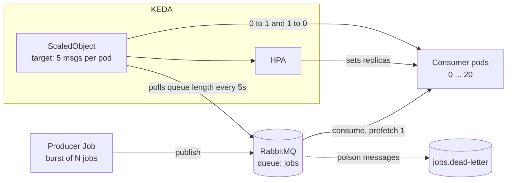

# keda-event-driven-autoscaling

Scale Kubernetes workers on **queue depth, not CPU**, from **zero** to dozens of pods and back to zero, using **KEDA** and **RabbitMQ**. An end-to-end test proves it on a real cluster in every CI run.


---

## The problem

Queue consumers (order processing, notifications, video encoding, report generation) don't fit the standard Kubernetes HPA:

- **CPU is the wrong signal.** A consumer waiting on I/O can sit at 5% CPU while 10,000 messages pile up.
- **The HPA can't scale to zero.** You pay for idle workers around the clock, even when the queue is empty for hours.
- **Over-provisioning is the usual fix,** and it's expensive.

## The solution

[KEDA](https://keda.sh) reads the queue length directly from RabbitMQ and drives the scaling:

| Queue state | Consumers |
|---|---|
| Empty | **0 pods**, no compute cost |
| Messages arrive | first pod in about 5 seconds |
| Backlog grows | about 1 pod per 5 waiting messages, up to 20 |
| Drained for 30 s | back to **0** |

I used the same pattern in production for RabbitMQ consumers on AKS for a global FMCG client.

## Architecture



## Scaling in action

Each CI run executes [`scripts/e2e-test.sh`](scripts/e2e-test.sh) on a fresh kind cluster and publishes the timeline to the run's summary (**Actions → latest run → Summary**). It has this shape:

```
elapsed  queue      consumers  event
0s       0          0          start: idle, scaled to zero
12s      300        0          producer finished publishing
17s      300        1
27s      268        4
37s      201        16
47s      64         20
57s      0          20         queue drained
...
112s     0          0          scaled back to zero
```

## What's in the repo

```
.
├── worker/                     # Python (pika): one image, two entrypoints
│   ├── src/worker/consumer.py  # prefetch=1, ack after work, graceful SIGTERM shutdown
│   ├── src/worker/producer.py  # publishes N persistent jobs with confirms
│   ├── src/worker/messages.py  # message schema + validation (unit-tested, 100% coverage)
│   └── Dockerfile              # slim, non-root, patched base
├── k8s/
│   ├── base/                   # RabbitMQ, consumer (replicas: 0), KEDA ScaledObject + TriggerAuthentication
│   ├── load-test/              # producer Job
│   └── overlays/local*/        # same manifests, using the image built locally for kind
├── scripts/
│   ├── kind-up.sh              # kind + KEDA + build + deploy
│   ├── load-test.sh            # fire a burst of jobs
│   ├── watch-scaling.sh        # live queue-depth vs. replicas view
│   └── e2e-test.sh             # automated 0 -> N -> 0 assertion
└── .github/workflows/ci.yml    # unit tests -> manifest validation + Trivy -> e2e on kind -> publish image
```

## Run it locally

Needs Docker, [kind](https://kind.sigs.k8s.io/), kubectl and Helm.

```bash
make up        # kind cluster + KEDA + RabbitMQ + consumer at 0 replicas
make watch     # terminal 2: live queue depth vs. consumer count
make load      # terminal 1: publish 300 jobs and watch it scale
make e2e       # or run the automated assertion
make down      # delete the cluster
```

RabbitMQ's management UI is available at `kubectl -n keda-demo port-forward svc/rabbitmq 15672` → http://localhost:15672 (demo credentials are in `k8s/base/kustomization.yaml`).

## Design decisions

| Decision | Why |
|---|---|
| `minReplicaCount: 0` | No messages, no pods, no cost. KEDA handles the 0 ↔ 1 step that the HPA can't. |
| Target `value: "5"` per pod | Matches about 5 seconds of buffered work per consumer at 1 s per job. Tune it to your job duration and latency goal. |
| `prefetch_count = 1` | Spreads work evenly as new pods arrive, and a pod being removed never holds a backlog. |
| Ack after processing, persistent messages, publisher confirms | Nothing is lost if a pod dies or scales in mid-job: unacked messages return to the queue. |
| Graceful SIGTERM handling + `terminationGracePeriodSeconds: 60` | On scale-in, the pod finishes and acks its current message before exiting. |
| Dead-letter queue | Malformed (poison) messages are rejected once and parked, instead of crash-looping consumers. |
| Fast scale-up, damped scale-down (HPA `behavior`) | React quickly to bursts; avoid flapping while the queue drains. |
| `TriggerAuthentication` from a Secret | KEDA never stores broker credentials in the ScaledObject. |
| Hardened pods | Non-root, read-only root filesystem, all capabilities dropped, seccomp `RuntimeDefault`, no service-account token. |

## Taking it to production

- Run RabbitMQ with the [Cluster Operator](https://www.rabbitmq.com/kubernetes/operator/operator-overview) (quorum queues, persistent volumes) or use a managed broker.
- Load credentials from AWS Secrets Manager or Azure Key Vault via External Secrets, and switch TriggerAuthentication to workload identity.
- Pair KEDA with Cluster Autoscaler or Karpenter so nodes scale with pods. See [terraform-aws-eks-platform](https://github.com/sharanushettar644/terraform-aws-eks-platform).
- Alert on dead-letter queue depth and on `keda_scaler_errors`.
- The same ScaledObject pattern works for Kafka lag, SQS, Azure Service Bus, Redis streams, Prometheus queries, and cron schedules.

## Author

**Sharanabasava Shettar**: DevOps Engineer | CKA, CKAD

I design Kubernetes platforms and autoscaling for event-driven workloads on AWS, Azure and GCP.
[LinkedIn](https://www.linkedin.com/in/sharanabasava-shettar)

## License

[MIT](LICENSE)
